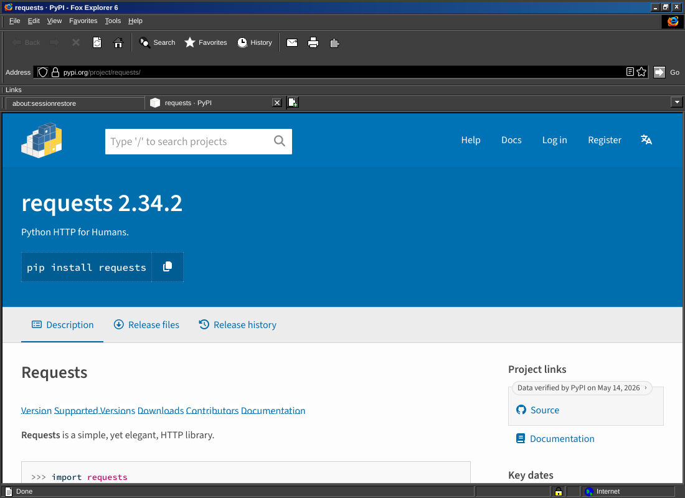
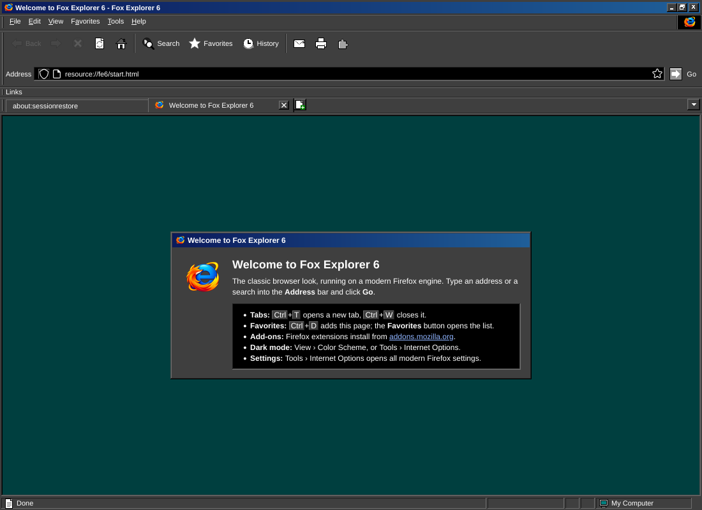
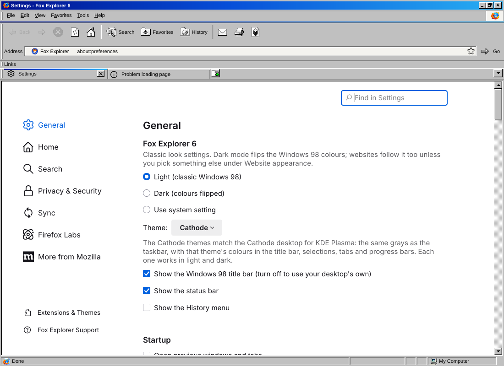

# Fox Explorer 6

**Firefox, dressed as Internet Explorer 6 on Windows 98** — for Fedora Linux 44 and other Linux systems.



Fox Explorer 6 is built from Mozilla's Firefox source ([mozilla-firefox/firefox](https://github.com/mozilla-firefox/firefox)).
It's still a current Firefox underneath, so tabs, Firefox extensions, Sync, private windows and
every modern setting work as normal. Only the look changes:

- **The IE6 window, top to bottom:** a Windows 98 caption bar with gradient and _ □ × buttons, then
  the File · Edit · View · Favorites · Tools · Help menu bar with an animated logo box on the right.
  Below that come the **Standard Buttons** (Back, Forward, Stop, Refresh, Home │ Search, Favorites,
  History │ Mail, Print), the **Address** bar with a **Go** button, the **Links** bar, Win98
  property-sheet **tabs**, the sunken page frame, and a **status bar** with progress, padlock and
  Internet / My Computer zone panes.
- **IE5/6 hot-tracking:** toolbar icons are grey until you point at them, then show colour on a
  raised bevel and press in when clicked.
- **Classic menus:** grey menus with navy highlight, etched separators, checkmarks and radio dots,
  and yellow tooltips. The menus are relabelled to **Favorites** ("Add to Favorites…", "Organize
  Favorites…") and **Tools › Internet Options…**, which opens Firefox's full settings.
- **Light mode:** the Windows 98 "Windows Standard" colour scheme.
- **Dark mode:** the same scheme with every colour's lightness flipped. The 3D lighting stays
  top-left, so buttons still look raised. Websites that support dark mode follow it.
- **Use System Setting:** follows GNOME/KDE light or dark automatically.

| Dark mode | Settings page |
|---|---|
|  |  |

Switch schemes from **View › Color Scheme**, or in **Tools › Internet Options** (the
*Fox Explorer 6* section at the top of General).

---

## Install on Fedora 44 (quick build, ~2 minutes)

This downloads the latest official Firefox release from Mozilla. It checks the release's SHA-512
and Mozilla's GPG signature, applies Fox Explorer 6 on top, and builds an RPM:

```bash
sudo dnf install python3 curl xz tar gnupg2 rpm-build
cd fox-explorer-6
scripts/build-repack.sh --rpm
sudo dnf install dist/foxexplorer6-*.x86_64.rpm      # or .aarch64.rpm on ARM
```

Then open **Fox Explorer 6** from your app grid, or run `foxexplorer6`.

Options: `--channel esr` (Firefox ESR instead of release), `--version 158.0.1`, `--lang de`,
`--from firefox-158.0.1.tar.xz` (use a tarball you already downloaded),
`--ie6-icons ~/IE6.iso` (use the real IE6 icons — see below).

### The original IE6 icons (optional)

Fox Explorer ships with its own Win98-style icons. If you have an Internet Explorer 6 setup CD
image, the build can use the **real IE6 toolbar and status-bar icons** from it instead: the grey
"cold" buttons that light up in colour on hover, the Go arrow, the IE page icon, padlock and
Internet-zone globe.

```bash
sudo dnf install cabextract
scripts/build-repack.sh --rpm --ie6-icons ~/Downloads/IE6.iso
```

Or add them to a copy that's already installed, without rebuilding:

```bash
sudo python3 scripts/import-ie6-icons.py ~/Downloads/IE6.iso /usr/lib64/foxexplorer6/foxexplorer/ie6
```

The icons are Microsoft's artwork, so they're converted on your machine from media you own and are
never stored in this repository (`theme/fe6/ie6/` is git-ignored). Don't share builds that include them.

### Other distributions

`scripts/build-repack.sh` (without `--rpm`) produces `dist/foxexplorer6-VERSION-ARCH.tar.xz`. Unpack it anywhere, then:

```bash
sudo ./foxexplorer6/foxexplorer/install.sh              # installs to /opt/foxexplorer6
sudo ./foxexplorer6/foxexplorer/install.sh --uninstall
```

### Keeping it updated — important

Mozilla's built-in updater is switched off, because it would overwrite the Fox Explorer changes.
**Re-run `scripts/build-repack.sh --rpm` whenever Firefox has a new release** (roughly every four
weeks, plus security fixes) and install the new RPM. `--channel esr` gives fewer, slower-moving
updates if you'd rather.

## Build from source

This compiles everything yourself from GitHub, with the Fox Explorer branding built in:

```bash
sudo dnf install git python3
scripts/build-from-source.sh --rpm                 # default branch: release
scripts/build-from-source.sh --branch esr153 --rpm
```

Here's what the script does:

1. Shallow-clones `https://github.com/mozilla-firefox/firefox` and adds
   `browser/branding/foxexplorer`.
2. Builds with [`packaging/mozconfig`](packaging/mozconfig): app name `foxexplorer6`, its own
   profile and window class, updater and crash reporter off.
3. Runs `./mach build && ./mach package`, then adds the IE6 layer and packages it like the quick
   build.

The first run installs Mozilla's toolchain with `./mach bootstrap`, which asks for sudo to install
dnf packages. A full build needs about **16 GB RAM** (8 GB plus swap works, slowly), **~40 GB disk**
and 1–3 hours.

---

## How it works

| Piece | What it does |
|---|---|
| [`theme/fe6/fe6.css`](theme/fe6/fe6.css) | The whole IE6 / Win98 look: palette, bevels, toolbar bands, menus, tabs, status bar. Light and dark are two sets of CSS variables. |
| [`theme/fe6/fe6-boot.sys.mjs`](theme/fe6/fe6-boot.sys.mjs) | Adds the caption bar, the IE buttons (as real CustomizableUI widgets, so **View › Toolbars › Customize** still works), the Address/Go row, throbber, status bar, menu changes and the Settings section. |
| [`autoconfig/`](autoconfig) | Firefox's standard *autoconfig* hook. It loads the above at startup and sets the defaults. |
| [`branding/foxexplorer/`](branding/foxexplorer) | Names, icons and About-box art. Source builds use it via `--with-branding`; the quick build patches it into `omni.ja` ([`scripts/rebrand-omni.py`](scripts/rebrand-omni.py)). |
| [`scripts/make-appini.py`](scripts/make-appini.py) | Gives Fox Explorer its own profile (`~/.mozilla/foxexplorer6`) and window class, so it sits beside a normal Firefox without sharing anything. Internally the app is still named *Firefox*, so websites and addons.mozilla.org treat it as Firefox. |
| [`art/`](art) | The app logo and the scripts that generate the icon set and branding sizes. |
| [`scripts/import-ie6-icons.py`](scripts/import-ie6-icons.py) | Optional: converts the original IE6 icons from your own IE6 CD image into the build. |

### Settings

All of these are in **about:config**, and most are also in **Tools › Internet Options**:

| Pref | Default | |
|---|---|---|
| `foxexplorer.colorScheme` | `light` | `light`, `dark` or `system` |
| `foxexplorer.classicTitlebar` | `true` | Win98 caption bar; `false` hands the title bar back to your desktop |
| `foxexplorer.statusBar` | `true` | also **View › Status Bar** |
| `foxexplorer.showHistoryMenu` | `false` | IE6 had no History menu; turn Firefox's back on |
| `foxexplorer.showAppMenu` | `false` | show Firefox's ≡ menu button |
| `foxexplorer.layoutVersion` | — | set to `0` and restart to reset the toolbar to the IE6 layout |

Your own `userChrome.css` still works on top (`toolkit.legacyUserProfileCustomizations.stylesheets` is on).

### Good to know

- **Artwork:** the default toolbar icons were drawn for this project in a Win98-style 16-colour
  palette. The app logo is in [`art/foxexplorer-logo.png`](art/foxexplorer-logo.png); run
  `art/make_branding.sh` after replacing it to regenerate every icon size. The logo combines
  elements of the Firefox and Internet Explorer logos, which are trademarks of Mozilla and
  Microsoft, so it's fine for personal use but worth replacing before publishing builds.
- **Fonts:** the UI asks for *MS Sans Serif / Tahoma* and falls back to Liberation Sans or Arial. For
  the most authentic text, install a Tahoma-compatible font, for example from Wine:
  `sudo dnf install wine-tahoma-fonts-system` (the `-system` package makes it available to all apps).
- **Title bar:** the Win98 caption needs Firefox's "custom title bar", which works on GNOME/KDE
  Wayland and on compositing X11 desktops. Where it isn't available, Fox Explorer falls back to
  your desktop's normal title bar automatically.
- The quick build uses Mozilla's official binary, so Mozilla's telemetry defaults apply. You can
  turn them off under **Internet Options › Privacy & Security**. Source builds made with unofficial
  branding don't send telemetry.
- Fox Explorer 6 is an unofficial project, not affiliated with Mozilla or Microsoft. Firefox is a
  trademark of the Mozilla Foundation, and Internet Explorer and Windows are trademarks of
  Microsoft. Released under the **MPL-2.0** ([LICENSE](LICENSE)), like Firefox.
