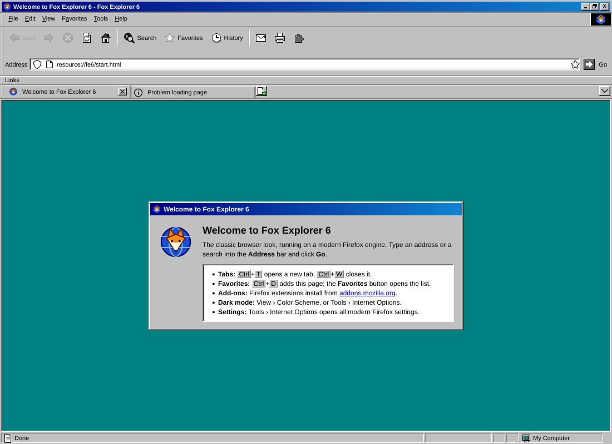
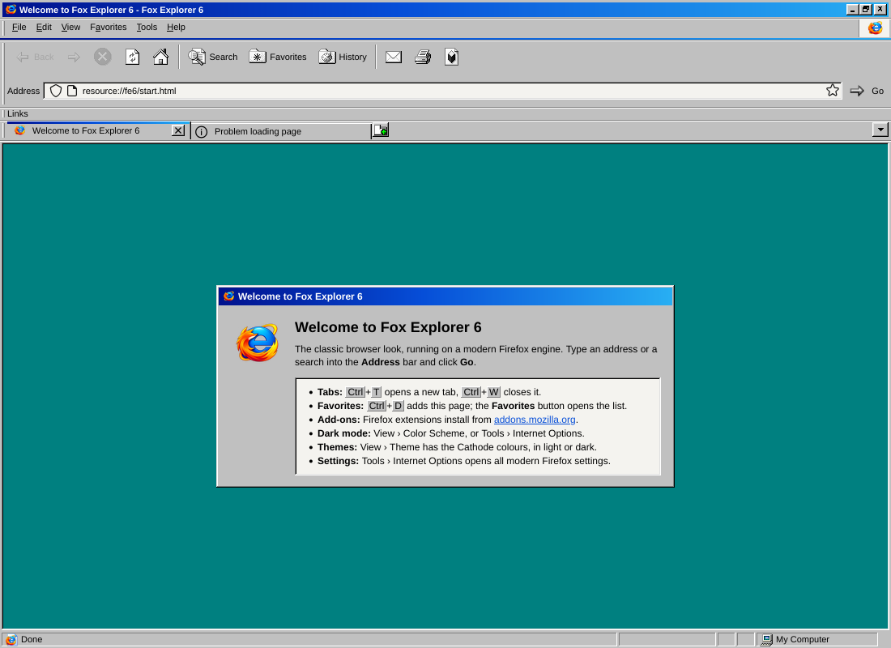
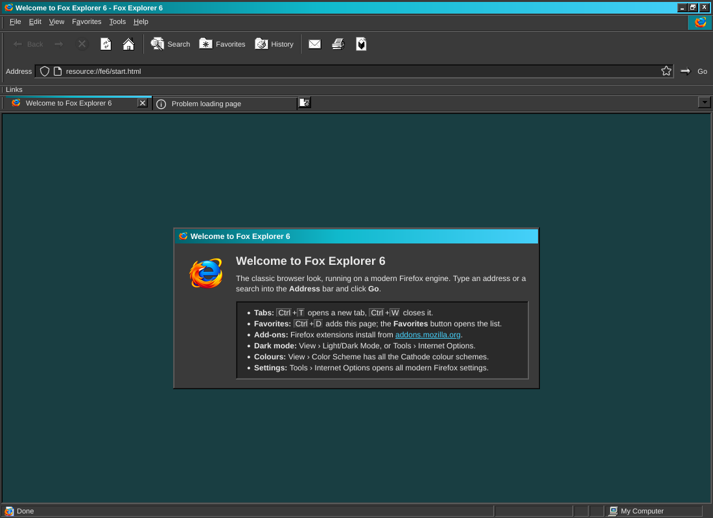
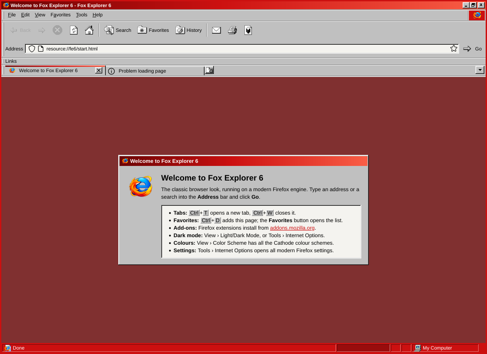
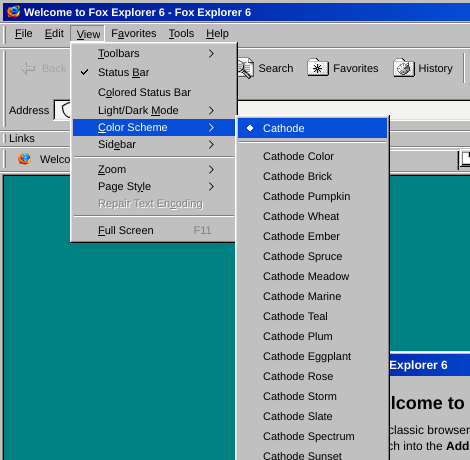

# Fox Explorer 6

**Firefox, dressed as Internet Explorer 6 on Windows 98** — for Fedora Linux 44 and other Linux systems.



Fox Explorer 6 is built from Mozilla's Firefox source ([mozilla-firefox/firefox](https://github.com/mozilla-firefox/firefox)).
It's still a current Firefox underneath, so tabs, Firefox extensions, Sync, private windows and
every modern setting work as normal. Only the look changes:

- **Search button:** IE6's Search lists your search engines; pick one to make it the default and
  type in the Address bar. **Manage Search Engines…** opens Firefox's search settings.
- **Windows 98 everywhere else:** classic scroll bars (with arrow buttons) on web pages and in the
  browser, plus Win98 controls in the sidebar, the Library, and the Add/Edit bookmark windows.
- **The IE6 window, top to bottom:** a Windows 98 caption bar with gradient and _ □ × buttons, then
  the File · Edit · View · Favorites · Tools · Help menu bar with an animated logo box on the right.
  Below that come the **Standard Buttons** (Back, Forward, Stop, Refresh, Home │ Search, Favorites,
  History │ Mail, Print), the **Address** bar with a **Go** button, the **Links** bar, Win98
  property-sheet **tabs**, the sunken page frame, and a **status bar** with progress, padlock and
  Internet / My Computer zone panes.
- **IE5/6 hot-tracking:** toolbar icons are grey until you point at them, then show colour on a
  raised bevel and press in when clicked.
- **Classic menus:** grey menus with blue highlight, etched separators, checkmarks and radio dots,
  and yellow tooltips. The menus are relabelled to **Favorites** ("Add to Favorites…", "Organize
  Favorites…") and **Tools › Internet Options…**, which opens Firefox's full settings.
- **Icons:** the toolbar, menus, sidebar, Library and status bar use the **SE98** icon set by
  [nestoris](https://github.com/nestoris/Win98SE) (GPL-2.0), a faithful Windows 98 SE style set.
- **Colour schemes:** **Cathode**, the standard scheme of the
  [Cathode KDE theme](https://github.com/Zachygd/Cathode-KDE-Theme), plus all its colour schemes:
  Cathode Color, Brick, Pumpkin, Wheat, Ember, Spruce, Meadow, Marine, Teal, Plum, Eggplant, Rose,
  Storm, Slate, Spectrum and Sunset. Every scheme uses the same grays as the Cathode taskbar and
  windows. The colour schemes add their colour as accents: the title bar, a stripe on the selected
  tab, the open menu, the logo box, selections, hot-tracked buttons, links, progress bars and the
  sidebar header.
- **Color Pop** (optional): the window's edges, the status bar and the frame round the page take
  the scheme's colour.
- **Light/Dark mode:** every scheme comes in light and dark (Cathode's dark grays), or
  **Use System Setting** to follow your desktop. Websites that support dark mode follow it.
- **No telemetry:** Mozilla's data collection, studies, sponsored content and background
  check-ins are switched off (see [Privacy](#privacy)).
- **Downloads:** while a file downloads, the Downloads button plays a Windows 98 style animation
  (a page flying from the globe into the folder) with a small block progress bar under it.

| Cathode Color | Cathode Teal, dark |
|---|---|
|  |  |
| **Cathode Brick with Color Pop** | **Cathode, dark** |
|  |  |

Pick a colour scheme from **View › Color Scheme**, light or dark from **View › Light/Dark Mode**,
and turn on **View › Color Pop** if you like. All three are also in **Tools › Internet
Options** (the *Fox Explorer 6* section at the top of General). Fox Explorer doesn't follow your
KDE colour scheme by itself: choose the matching one once and it stays.

| View › Color Scheme | Internet Options |
|---|---|
|  |  |

---

## Install on Fedora 44 (quick build, ~2 minutes)

This downloads the latest official Firefox release from Mozilla. It checks the release's SHA-512
and Mozilla's GPG signature, applies Fox Explorer 6 on top, and builds an RPM:

```bash
sudo dnf install python3 curl xz tar gnupg2 rpm-build
cd fox-explorer-6
scripts/build-repack.sh --rpm
sudo dnf install dist/foxexplorer6-*.x86_64.rpm      # or .aarch64.rpm on ARM
```

Then open **Fox Explorer 6** from your app grid, or run `foxexplorer6`.

Options: `--channel esr` (Firefox ESR instead of release), `--version 158.0.1`, `--lang de`,
`--from firefox-158.0.1.tar.xz` (use a tarball you already downloaded).

### AppImage (any Linux, nothing to install)

```bash
scripts/build-repack.sh --appimage            # makes dist/FoxExplorer6-VERSION-x86_64.AppImage
chmod +x dist/FoxExplorer6-*.AppImage && ./dist/FoxExplorer6-*.AppImage
```

The AppImage uses the same profile as the installed version (`~/.mozilla/foxexplorer6`).
`--rpm --appimage` builds both at once.

**Releases on GitHub:** the *Build release* workflow (Actions tab › *Build release* › *Run
workflow*) builds the AppImage, the RPM and the tarball from the latest Firefox on GitHub's
servers and publishes them as a release named after the Firefox version.

### Other distributions

`scripts/build-repack.sh` (without `--rpm`) produces `dist/foxexplorer6-VERSION-ARCH.tar.xz`. Unpack it anywhere, then:

```bash
sudo ./foxexplorer6/foxexplorer/install.sh              # installs to /opt/foxexplorer6
sudo ./foxexplorer6/foxexplorer/install.sh --uninstall
```

### Keeping it updated — important

Mozilla's built-in updater is switched off, because it would overwrite the Fox Explorer changes.
**Re-run `scripts/build-repack.sh --rpm` whenever Firefox has a new release** (roughly every four
weeks, plus security fixes) and install the new RPM. The same command picks up Fox Explorer's own
updates:

```bash
cd ~/fox-explorer-6 && git pull && scripts/build-repack.sh --rpm && sudo dnf install ./dist/foxexplorer6-*.rpm
```

Use `dnf install`, not `dnf reinstall`: every build has a newer release number, and `install`
upgrades to it. Then close every Fox Explorer window and start it again. `--channel esr` gives fewer, slower-moving
updates if you'd rather.

## Build from source

This compiles everything yourself from GitHub, with the Fox Explorer branding built in:

```bash
sudo dnf install git python3
scripts/build-from-source.sh --rpm                 # default branch: release
scripts/build-from-source.sh --branch esr153 --rpm
```

Here's what the script does:

1. Shallow-clones `https://github.com/mozilla-firefox/firefox` and adds
   `browser/branding/foxexplorer`.
2. Builds with [`packaging/mozconfig`](packaging/mozconfig): app name `foxexplorer6`, its own
   profile and window class, updater and crash reporter off.
3. Runs `./mach build && ./mach package`, then adds the IE6 layer and packages it like the quick
   build.

The first run installs Mozilla's toolchain with `./mach bootstrap`, which asks for sudo to install
dnf packages. A full build needs about **16 GB RAM** (8 GB plus swap works, slowly), **~40 GB disk**
and 1–3 hours.

---

## How it works

| Piece | What it does |
|---|---|
| [`theme/fe6/fe6.css`](theme/fe6/fe6.css) | The whole IE6 / Win98 look: palette, bevels, toolbar bands, menus, tabs, status bar. Light and dark are two sets of CSS variables. |
| [`theme/fe6/fe6-boot.sys.mjs`](theme/fe6/fe6-boot.sys.mjs) | Adds the caption bar, the IE buttons (as real CustomizableUI widgets, so **View › Toolbars › Customize** still works), the Address/Go row, throbber, status bar, menu changes and the Settings section. |
| [`autoconfig/`](autoconfig) | Firefox's standard *autoconfig* hook. It loads the above at startup and sets the defaults. |
| [`branding/foxexplorer/`](branding/foxexplorer) | Names, icons and About-box art. Source builds use it via `--with-branding`; the quick build patches it into `omni.ja` ([`scripts/rebrand-omni.py`](scripts/rebrand-omni.py)). |
| [`scripts/make-appini.py`](scripts/make-appini.py) | Gives Fox Explorer its own profile (`~/.mozilla/foxexplorer6`) and window class, so it sits beside a normal Firefox without sharing anything. Internally the app is still named *Firefox*, so websites and addons.mozilla.org treat it as Firefox. |
| [`art/`](art) | The app logo and the scripts that generate the icon set and branding sizes. |
| [`theme/fe6/se98/`](theme/fe6/se98) | The SE98 icons by nestoris (GPL-2.0) and `se98.css`, which puts them on Firefox's buttons. Made by [`art/make_se98.py`](art/make_se98.py) from a clone of [Win98SE](https://github.com/nestoris/Win98SE); the Downloads animation by [`art/make_download_anim.py`](art/make_download_anim.py). |
| [`theme/fe6/fe6-themes.css`](theme/fe6/fe6-themes.css) | The Cathode colour schemes (plain Cathode and every colour scheme), light and dark. Made by [`art/make_themes.py`](art/make_themes.py) from the Cathode KDE theme's colour table (`build/schemes.py`), so a new Cathode scheme is one re-run away. |

### Settings

All of these are in **about:config**, and most are also in **Tools › Internet Options**:

| Pref | Default | |
|---|---|---|
| `foxexplorer.colorScheme` | `light` | Light/Dark mode: `light`, `dark` or `system` |
| `foxexplorer.theme` | `classic` | Colour scheme: `classic` (Cathode) or `cathode`, `brick`, `pumpkin`, `wheat`, `ember`, `spruce`, `meadow`, `marine`, `teal`, `plum`, `eggplant`, `rose`, `storm`, `slate`, `spectrum`, `sunset` (`cathode` is Cathode Color) |
| `foxexplorer.colorPop` | `false` | also **View › Color Pop** |
| `foxexplorer.classicTitlebar` | `true` | Win98 caption bar; `false` hands the title bar back to your desktop |
| `foxexplorer.statusBar` | `true` | also **View › Status Bar** |
| `foxexplorer.showHistoryMenu` | `false` | IE6 had no History menu; turn Firefox's back on |
| `foxexplorer.showAppMenu` | `false` | show Firefox's ≡ menu button |
| `foxexplorer.layoutVersion` | — | set to `0` and restart to reset the toolbar to the IE6 layout |

Your own `userChrome.css` still works on top (`toolkit.legacyUserProfileCustomizations.stylesheets` is on).

### Good to know

- **Artwork:** the icons are SE98 by nestoris (see above). A few small pieces SE98 doesn't cover
  (the title-bar buttons, menu checkmarks, the toolbar chevron) were drawn for this project in a
  Win98-style 16-colour palette. The app logo is in
  [`art/foxexplorer-logo.png`](art/foxexplorer-logo.png); run `art/make_branding.sh` after
  replacing it to regenerate every icon size. The logo combines elements of the Firefox and
  Internet Explorer logos, which are trademarks of Mozilla and Microsoft, so it's fine for
  personal use but worth replacing before publishing builds.
- **Fonts:** the UI asks for *MS Sans Serif / Tahoma* and falls back to Liberation Sans or Arial. For
  the most authentic text, install a Tahoma-compatible font, for example from Wine:
  `sudo dnf install wine-tahoma-fonts-system` (the `-system` package makes it available to all apps).
- **Title bar:** the Win98 caption needs Firefox's "custom title bar", which works on GNOME/KDE
  Wayland and on compositing X11 desktops. Where it isn't available, Fox Explorer falls back to
  your desktop's normal title bar automatically. On the Cathode desktop you can also untick
  *Show the Windows 98 title bar* in Internet Options to get KDE's own Cathode window decoration.
- **Square windows:** with its own title bar, Firefox lets GTK draw a frame round the window from
  your GTK theme (rounded corners and a shadow with Breeze, a beige bevel with Chicago95). The
  `foxexplorer6` launcher gives Fox Explorer a small GTK theme of its own, made from your current
  one minus that frame, so the window's edge is Fox Explorer's own Win98 (or Color Pop) frame.
  Other apps aren't affected. Set `FE6_KEEP_GTK_FRAME=1` to keep the GTK frame.
- **Privacy:** see below — Fox Explorer sends nothing to Mozilla about how you use it.
- Fox Explorer 6 is an unofficial project, not affiliated with Mozilla or Microsoft. Firefox is a
  trademark of the Mozilla Foundation, and Internet Explorer and Windows are trademarks of
  Microsoft. Released under the **MPL-2.0** ([LICENSE](LICENSE)), like Firefox. The SE98 icons in
  [`theme/fe6/se98/`](theme/fe6/se98) are by nestoris and stay under their own licence, the
  **GPL-2.0** ([theme/fe6/se98/LICENSE](theme/fe6/se98/LICENSE)).

### Privacy

Fox Explorer has Mozilla's data collection switched off and locked, on both the quick build and
source builds:

- **No telemetry**: no usage data, health reports, daily pings, crash reports or ad attribution
  are sent to Mozilla. The "sends some data to Mozilla" bar never appears.
- **No studies or experiments**: Mozilla can't remotely enrol Fox Explorer in tests (Normandy,
  Nimbus).
- **No sponsored content**: no sponsored shortcuts, Pocket stories, sponsored Address bar
  suggestions, weather or trending searches, add-on recommendations or Mozilla promos.
- **No background check-ins**: no region lookup, no captive-portal checks every few minutes, and
  no always-open connection to Mozilla's push server. (Turn these back on in about:config if you
  need them: `network.captive-portal-service.enabled` helps with hotel/airport Wi-Fi sign-in
  pages, `dom.push.connection.enabled` lets websites send you push notifications.)

What it still connects to, on purpose:

| Server | Why |
|---|---|
| `firefox.settings.services.mozilla.com` | Security lists: revoked certificates, blocked malicious add-ons and similar. Nothing about you is sent. |
| `services.addons.mozilla.org` | Updates for the extensions you install. |
| `aus5.mozilla.org`, `ciscobinary.openh264.org` | The video codec and the DRM module that Netflix, Prime Video and similar sites need. |
| Your search engine | Search suggestions while you type (turn off under **Internet Options › Search**). |

**Google Safe Browsing is off**, so nothing goes to Google unless you search with it. (You can
turn it back on under **Internet Options › Privacy & Security › Block dangerous and deceptive
content** if you want phishing and malware warnings.) Mozilla's own tracking protection is
separate and stays on.

Firefox's own accent colour (used for some of its built-in controls) is set to your Cathode
colour scheme, so the desktop's accent colour never shows through.

Sync and Mozilla accounts are only contacted if you sign in.

